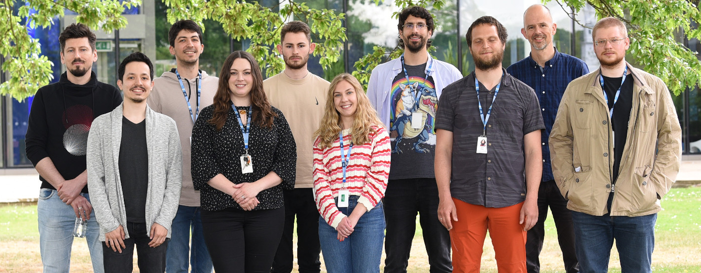
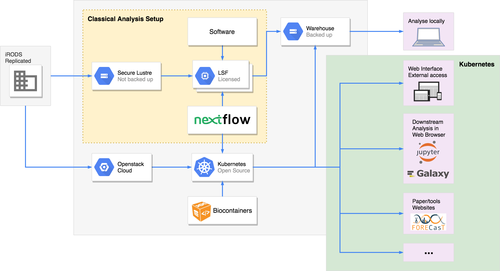

The group
=========

Our story
---------

Cellular Genetics programme (2015)
~~~~~~~~~~~~~~~~~~~~~~~~~~~~~~~~~~

The Cellular Genetics programme at the Sanger Institute was created in 2015 by merging with the Computational Genomics programme. In the first two years the programme didn't have any core facility groups. In 2017 it was decided to create several core facility groups including ours to help the faculty groups do their research.

In the early days of the programme (the first 2 years) all of the users analysed their data by themselves on the `LSF batch compute farm <https://www.ibm.com/docs/en/spectrum-lsf/10.1.0?topic=overview-lsf-introduction>`_ available at the Sanger. This included both computational and non-computational users. Some people had never coded before. This introduced a lot of heterogeneity in the programme data.

Cloud (2017)
~~~~~~~~~~~~

In 2017 it was decided by Wellcome Trust to adapt to the modern cloud technologies and to move their compute to the cloud. The Sanger Institute decided to start with having a private OpenStack cloud on premises and gradually move analysis from the LSF farm to the cloud. It created additional challenges for the end users and therefore it was decided to create the Cellular Genetics core facility informatics group which would standardize the analysis and help with transitioning to the cloud.

Cellular Genetics Informatics group (2018)
~~~~~~~~~~~~~~~~~~~~~~~~~~~~~~~~~~~~~~~~~~

`Our group <https://www.sanger.ac.uk/group/cellular-genetics-informatics>`__ was created in the beginning of 2018 and `Vladimir Kiselev <https://www.sanger.ac.uk/person/kiselev-vladimir-yu/>`_ started as the head of the group. `Stijn van Dongen <https://www.sanger.ac.uk/person/van-dongen-stijn/>`_ joined the group in May 2018 and `Anton Khodak <https://www.sanger.ac.uk/person/khodak-anton/>`_ joined the group in June 2018. Since then, our group has grown extensively and we have developed, implemented and maintained multiple pipelines as well as hosting a JupyterHub openstack instance. There is also alot of communication between members of our team and the faculty to aid in research including developing websites for their research publications.

Cellular Genetics Informatics group (2023)
~~~~~~~~~~~~~~~~~~~~~~~~~~~~~~~~~~~~~~~~~~
In 2023, `Martin Prete <https://www.sanger.ac.uk/person/prete-martin/>`_ took over as team leader.  The team shifted its focus from OpenStack clusters towards scalable, LSF-based computational solutions, with an increased emphasis on reproducibility. To improve the researcher experience, the team also prioritised self-service research environments such as JupyterHub and Open OnDemand. This transition reflected a broader commitment to providing researchers with accessible, flexible, and scalable computational infrastructure that supports scientific discovery.

Cellular Genomics Informatics group (2025)
~~~~~~~~~~~~~~~~~~~~~~~~~~~~~~~~~~~~~~~~~~
In 2025, the programme was renamed to ``Cellular Genomics``. 

Our remit
---------

Group
~~~~~

Our team is a **science-embedded computational biology and bioinformatics unit** within the Cellular Genomics programme at the Wellcome Sanger Institute. We work in close partnership with faculty and research groups, contributing directly to scientific discovery through a combination of scientific insight, computational expertise, and collaborative research.

Our remit spans both **scientific and bioinformatics research**, from developing and applying cutting-edge analytical methods to designing, building, and operating the workflows, tools, and infrastructure that enable research at scale.

By working alongside researchers throughout the scientific process, we help shape research questions, develop analytical strategies, interpret results, and deliver computational solutions that advance the programme's scientific goals, including its contributions to major international initiatives such as the `Human Cell Atlas <https://www.humancellatlas.org/>`_. and Human Induced Pluripotent Stem Cell Initiative (`HIPSCI <https://www.hipsci.org/>`_).

Compute framework
~~~~~~~~~~~~~~~~~

To run our pipelines we use both the `LSF compute cluster <https://www.ibm.com/docs/en/spectrum-lsf/10.1.0?topic=overview-lsf-introduction>`_ and `OpenStack private cloud <https://www.openstack.org/>`_ solutions. We have used `Kubernetes <https://kubernetes.io/>`_ to orchestrate pipelines on the cloud but prefer on-premise infrastructure and platforms. To run the pipelines we use mainly use `Nextflow <https://www.nextflow.io/>`_.

`Our GitHub organisation <https://github.com/cellgeni>`_

Our vision
----------

Our vision is to advance scientific discovery through close collaboration with researchers, combining scientific expertise, computational innovation, and robust, reproducible analytical solutions.

When working on collaborative research, projects, and pipelines, we follow several core principles.

Scientific collaboration
~~~~~~~~~~~~~~~~~~~~~~~~

We work closely with faculty and research groups as scientific partners, contributing to experimental design, analytical strategies, data interpretation, and research outcomes. We encourage shared ownership of scientific challenges and collaborative development of solutions.

No duplication of effort
~~~~~~~~~~~~~~~~~~~~~~~~

We prioritise existing tools, methods, and community standards whenever appropriate, contributing to and extending them rather than unnecessarily developing new solutions.

Agile and adaptable
~~~~~~~~~~~~~~~~~~~

We adopt elements of the `Agile methodology <https://en.wikipedia.org/wiki/Agile_software_development>`_ to manage our work, respond to evolving scientific requirements, and deliver improvements incrementally. We use Jira as our main project management platform.

Research-driven
~~~~~~~~~~~~~~~

Our priorities are shaped by the scientific needs of the Cellular Genomics programme. We work closely with researchers to understand their challenges, identify opportunities for computational innovation, and develop solutions that support scientific discovery.

Researchers can contact us through `FreshService <https://sanger.freshservice.com/>`_, by email at ``cellgeni [at] sanger.ac.uk``, or through the `Cellular Genomics Slack workspace <https://sanger-cellgen.slack.com>`__.

Open communication and feedback
~~~~~~~~~~~~~~~~~~~~~~~~~~~~~~~

We maintain regular communication with faculty and research groups, including monthly meetings with faculty group representatives. We welcome feedback and ideas at any time through our support channels and collaborative discussions.
